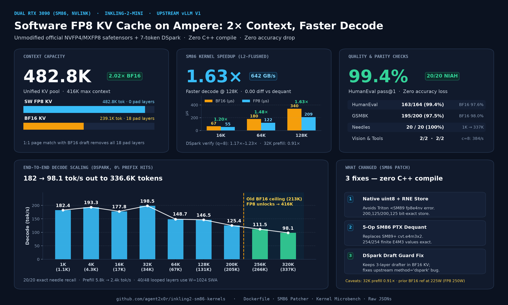
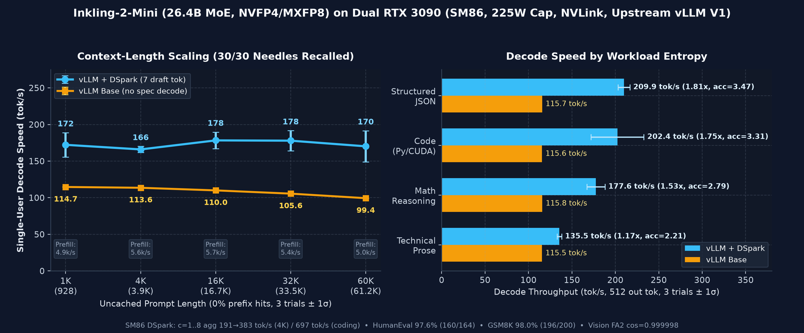

# Inkling-2-Mini on Ampere (SM86 / Dual RTX 3090) in Upstream vLLM V1

Native **NVFP4/MXFP8 MoE + Software FP8 (`E4M3FN`) KV Cache (416K Context) + Vision (FA2) + Tool Calling + 7-Token DSpark Speculative Decoding** for [`thinkingmachines/Inkling-2-Mini`](https://huggingface.co/thinkingmachines/Inkling-2-Mini) on **Ampere (SM80/SM86)** GPUs inside **upstream vLLM V1** — **zero C++ compilation required**.



## Software FP8 (`E4M3FN`) KV Cache on SM86 (416K Context / 482.8K Pool)

### What This Accomplishes
- **Doubles context capacity (`2.02×` KV pool, `416K` single-request `max_model_len=425984`):** On a dedicated 2× RTX 3090 (`0.98` util, `250W`), unified KV capacity jumps from `239,061` tokens (`212,992` max len) to **`482,810` tokens** (`8.26 GiB/GPU`, `67,664` blocks, `1.13×` concurrency at `425,984`). Bonus: FP8 target pages (`block_size=128`, 1 B/elem) match BF16 DSpark draft pages (`block_size=64`, 2 B/elem) **1:1**, eliminating all **18 hybrid padding layers** (previously up to 350% waste in the draft KV group).
- **Speeds up long-context attention on Ampere (`1.63×` faster decode kernel at 128K):** L2-flushed RTX 3090 kernel microbenchmarks (`H=12, HKV=4, D=128`) measure **`1.20×`** (16K), **`1.48×`** (64K), and **`1.63×`** (128K: `340.0 µs → 208.9 µs`, `642.5 GB/s` effective FP8 read BW) for decode, and **`1.17×–1.23×`** for 8-token DSpark verify — with **`0.0e+00`** max diff vs dequantized BF16 KV.
- **Sustains `182 → 98.1 tok/s` decode out to `336,567` uncached tokens (`20/20` NIAH):** Single-user DSpark decode runs `182.4 tok/s` (1K) → `198.5 tok/s` (32K) → `148.7 tok/s` (67.2K) → `146.5 tok/s` (130.9K) → `111.5 tok/s` (265.7K) → **`98.1 tok/s` at 336.6K tokens**, with `0` prefix cache hits and `100%` needle recall at every bucket.
- **Zero accuracy or feature loss:** **`99.39%`** HumanEval (`163/164` at `597.7 tok/s` agg, vs BF16 `160/164` / `97.56%`), **`97.5%`** GSM8K (`195/200` at `552.4 tok/s` agg, vs BF16 `196/200` / `98.0%`), **`2/2`** Vision FA2, **`2/2`** Tool Calling, and **`384.4 tok/s`** `c=8` concurrency (matching BF16 `383.4 tok/s`).
- **Honest caveats:** Compute-bound 32K prefill attention (`q=256`) is `0.91×` vs BF16 due to software dequant ALU instructions, and the earlier checked-in BF16 speed/accuracy baseline ran at `225W` (`0.85` util) whereas the dedicated FP8 KV runs used `250W` (`0.98` util; KV pool numbers `239,061` vs `482,810` were both measured on the exact same `250W` / `0.98` util setup).

### What Changed (Under the Hood — Zero C++ Compile)
Ampere (`SM86`) lacks Ada/Hopper's `cvt.rn.f16x2.e4m3x2` instruction, and Triton rejects `fp8e4nv` pointer arguments on `< SM89`. Because `Inkling-2-Mini`'s `attention_prologue` already L2-clips K (`<= 22.63`) and RMS-normalizes V (`RMS = 1.0`), both fit unit-scale `E4M3FN` (`[-448, 448]`) with no calibration scales. [`vllm_sm86/apply_sm86_patch.py`](vllm_sm86/apply_sm86_patch.py) adds three idempotent Python/Triton fixes (plus [`vllm_sm86/serve_inkling2_sm86.sh`](vllm_sm86/serve_inkling2_sm86.sh) defaulting to `KV_CACHE_DTYPE=fp8`, `MAX_MODEL_LEN=425984`):

1. **Native `uint8` KV Storage + Exact IEEE-754 RNE Store (`nvidia/attention.py`, `nvidia/ops/sconv.py`):** Keeps vLLM's `torch.uint8` cache tensor on `< SM89` so Triton never lowers an unsupported `fp8e4nv` pointer, and adds pure-Triton `_fp32_to_e4m3fn_u8` (**`200,125/200,125`** bit-exact vs `torch.float8_e4m3fn` across normals, subnormals, ties-to-even, and saturation).
2. **5-Op SM80/SM86 PTX `E4M3` Dequant Load (`nvidia/ops/attention_sm90.py`):** Replaces SM89+ `cvt.rn.f16x2.e4m3x2` with `prmt.b32 0x1707` + `and` + `shr` + `lop3 0xEC` + non-FTZ `mul.rn.f16x2` by `256.0` — **`254/254`** finite `E4M3FN` values bit-exact, zero register spills, and `0.0e+00` diff vs dequantized BF16 across SWA and full attention.
3. **DSpark Draft BF16 Guard & Upstream Config Bug Fix (`inkling2/speculator_config.py`, `v1/worker/gpu/spec_decode/speculator_config.py`):** Extends the BF16 draft KV guard to `< SM90` and fixes upstream `_resolve_checkpoint_config_class` returning base `DSparkSpeculatorConfig` instead of `Inkling2DSparkSpeculatorConfig` whenever `method="dspark"` is explicitly set (which previously skipped `adapt_draft_model_config`).

<details>
<summary><b>View Full Software FP8 KV Tables (Capacity/Accuracy, 1K–337K Scaling, SM86 Kernel Microbench)</b></summary>

### BF16 KV vs Software FP8 KV (Dual RTX 3090, TP=2, DSpark)

| Metric | BF16 KV (`auto`) | Software FP8 KV (`fp8`) | Delta / Notes |
| :--- | ---: | ---: | :--- |
| **Unified KV Pool (`0.98` util)** | `239,061` tokens | **`482,810` tokens** | **`2.02×`** capacity (`8.26 GiB/GPU`) |
| **Max Single-User Context** | `212,992` (`1.12×`) | **`425,984` (`1.13×`)** | **`2.00×`** `max_model_len` (`416K`) |
| **Hybrid Padding Layers** | `18` layers (`<=350%` waste) | **`0`** | FP8 `128×1B` == BF16 draft `64×2B` |
| **HumanEval pass@1 (164)** | `160/164` (`97.56%`) | **`163/164` (`99.39%`)** | `597.7 tok/s` agg (`c=8`) |
| **GSM8K Accuracy (200)** | `196/200` (`98.0%`) | **`195/200` (`97.5%`)** | `552.4 tok/s` agg (`c=8`) |
| **Needle Recall (0% hits)** | `15/15` (`1K–60K`) | **`20/20` (`100%`)** | `1K → 336,567` tokens |
| **Vision FA2 / Tool Calls** | `2/2` · `2/2` | **`2/2` · `2/2`** | Exact JSON args + FA2 parity |
| **`c=8` Concurrency (4K/user)** | `383.4 tok/s` agg | **`384.4 tok/s` agg** | 12 greedy prompts: `239.3 tok/s` |

*KV pool stats measured on the same dedicated 2× RTX 3090 (`250W`, `0.98` util). Checked-in BF16 speed/accuracy reference ran earlier at `225W`, `0.85` util.*

### End-to-End Long-Context Scaling (`results_dspark_fp8kv.json` + `results_longctx_fp8kv.json`)

| Bucket | Prompt Tok | TTFT | Prefill (tok/s) | DSpark Decode (tok/s) | Acc Len | Prefix Hits | NIAH |
| :--- | ---: | ---: | ---: | ---: | ---: | ---: | :---: |
| **1K** | `1,144` | `0.27 ± 0.04s` | `4,273` | **`182.4 ± 21.6`** | `2.92` | `0` | `3/3` |
| **4K** | `4,335` | `0.81 ± 0.11s` | `5,424` | **`193.3 ± 21.1`** | `3.13` | `0` | `3/3` |
| **16K** | `16,997` | `2.91 ± 0.06s` | `5,837` | **`177.8 ± 21.1`** | `2.91` | `0` | `3/3` |
| **32K** | `34,017` | `6.18 ± 0.00s` | `5,501` | **`198.5 ± 17.7`** | `3.34` | `0` | `3/3` |
| **60K** | `63,296` | `12.93 ± 0.02s` | `4,896` | **`157.0 ± 9.2`** | `2.74` | `0` | `3/3` |
| **64K** | `67,163` | `13.75s` | `4,886` | **`148.7`** | `2.59` | `0` | `1/1` |
| **128K** | `130,946` | `33.45s` | `3,914` | **`146.5`** | `2.76` | `0` | `1/1` |
| **200K** | `204,739` | `64.42s` | `3,178` | **`125.4`** | `2.59` | `0` | `1/1` |
| **256K** | `265,665` | `96.48s` | `2,754` | **`111.5`** | `2.46` | `0` | `1/1` |
| **320K** | `336,567` | `140.80s` | `2,390` | **`98.1`** | `2.34` | `0` | `1/1` |

### SM86 Attention Kernel Microbenchmark (`benchmarks/results_kernel_fp8kv.json`, Idle RTX 3090, L2-Flushed)

| Attention Regime (`H=12, HKV=4, D=128`) | BF16 KV | SW FP8 KV | Speedup | FP8 Read BW | Max Diff vs Dequant BF16 |
| :--- | ---: | ---: | ---: | ---: | ---: |
| **Decode `q=1`, 16K KV (20 splits)** | `66.6 µs` | **`55.3 µs`** | **`1.20×`** | `303.4 GB/s` | `0.0e+00` |
| **Decode `q=1`, 64K KV (20 splits)** | `180.2 µs` | **`121.9 µs`** | **`1.48×`** | `550.7 GB/s` | `0.0e+00` |
| **Decode `q=1`, 128K KV (20 splits)** | `340.0 µs` | **`208.9 µs`** | **`1.63×`** | `642.5 GB/s` | `0.0e+00` |
| **DSpark Verify `q=8`, 16K KV (20 splits)** | `71.8 µs` | **`61.4 µs`** | **`1.17×`** | `273.1 GB/s` | `0.0e+00` |
| **DSpark Verify `q=8`, 64K KV (20 splits)** | `185.3 µs` | **`150.5 µs`** | **`1.23×`** | `445.8 GB/s` | `0.0e+00` |
| **DSpark Verify `q=8`, 128K KV (20 splits)** | `340.0 µs` | **`285.7 µs`** | **`1.19×`** | `469.8 GB/s` | `0.0e+00` |
| **Prefill `q=256`, 32K KV (`BM128`)** | `2,798.6 µs` | `3,072.0 µs` | `0.91×` | compute-bound | `0.0e+00` |

See [`vllm_sm86/FP8_KV_TODO.md`](vllm_sm86/FP8_KV_TODO.md) for PTX unpack details and [`benchmarks/fp8kv_tables/`](benchmarks/fp8kv_tables/) for standalone PNG tables.

</details>

---

## Baseline BF16 KV Results (2× RTX 3090, 225W Cap, NVLink, TP=2)



Tested on **2× NVIDIA GeForce RTX 3090** (`SM86`, 24 GiB GDDR6X each, 225 W power limit, NV4 NVLink bridge measuring `52.7 GB/s` unidirectional P2P and `840.4 GB/s` GDDR6X bandwidth), driven by an AMD FX-8350 (2012) host sharing the GPUs with ~2.2 GiB/GPU of co-resident services.

- **Single-user decode (Base / no spec decode):** `114.7 ± 0.1 tok/s` (1K) → **`99.4 ± 0.1 tok/s`** (61.2K uncached context, 0% prefix hits)
- **Single-user decode (DSpark, 7 draft tokens):** **`166–178 tok/s`** from 1K to 33.5K and **`170.2 ± 21.3 tok/s`** at **61.2K uncached context**; **`209.9 tok/s`** on structured JSON and **`202.4 tok/s`** on code
- **Uncached prefill:** **`4,918–5,709 tok/s`** (1K–16K) and **`4,954 tok/s`** at 61.2K (`12.36 s` TTFT)
- **Multi-user concurrency (`~4K` uncached prompt/user, unified paged KV):** DSpark scales monotonically **`190.6 → 277.9 → 352.6 → 383.4 tok/s`** aggregate (`c = 1, 2, 4, 8`), beating Base (`113.5 → 173.9 → 249.0 → 328.1 tok/s`) at every concurrency level; short-prompt coding reaches **`697.1 tok/s`** aggregate (`c = 8`)
- **Unified Hybrid KV Cache & `n`-Parallel Sampling:** Native vLLM V1 `HybridKVCacheManager` (`81,966` unified KV tokens across `5,712` paged blocks and `max_num_seqs = 32`), Automatic Prefix Caching (`99.2%` block reuse on shared 6.2K prompts), and OpenAI `n > 1` parallel sampling (`n = 4` verified at `358.1 tok/s` aggregate)
- **Accuracy on SM86 DSpark:** **`97.56%`** HumanEval (`160/164`; `96.34%` raw before fixing a harness helper-prefix bug), **`98.0%`** GSM8K (`196/200`; `95.0%` strict raw), **`30/30`** long-context needle recall (1K–61.2K), **`cos = 0.999998`** vision FA2 numerical parity vs FP32 SDPA, and `2/2` structured tool calling

---

## Exact Checkpoint & Precision Breakdown

All runs use the **single official, unmodified upstream safetensors checkpoint** from Hugging Face (**no GGUF, no third-party re-quantization**):

- **Hugging Face Repo & Revision:** [`thinkingmachines/Inkling-2-Mini`](https://huggingface.co/thinkingmachines/Inkling-2-Mini) @ `ed40e7da625f594fc9c4990f5f66be24873c22d7`
- **Files:** `model-00001-of-00001.safetensors` (`18.19 GiB`, 1,244 tensors) + `mtp.safetensors` (`0.59 GiB`, 54 tensors)
- **Quantization recipe (`config.json` + `hf_quant_config.json`):** `modelopt` mixed-precision checkpoint (`quant_algo: "NVFP4"` at top level, per-layer mixed precision below):

| Component | Weight Format in Safetensors | Size | Execution on SM86 (RTX 3090) |
| :--- | :--- | ---: | :--- |
| **Routed MoE Experts — Layers `0–19`** (40 tensors) | **NVFP4** (`E2M1` packed `uint8`, `1×16` blocks, `FP8 E4M3` scales + outer `amax`) | `9.61 GiB` | Humming `sm_86` **W4A16** (register dequant → BF16 Tensor Cores) |
| **Routed MoE Experts — Layers `20–23`** (8 tensors) | **MXFP8** (`FP8 E4M3`, `32×32` blocks, `UE8M0` scales) | `4.98 GiB` | Humming `sm_86` **W8A16** (register dequant → BF16 Tensor Cores) |
| **Attention, Embeddings, `unembed`, Shared Experts, `short_conv`, Vision** (994 tensors) | **BF16** | `3.59 GiB` | Native BF16 Tensor Cores |
| **Attention-Residual Queries & Norms** (74 tensors) | **FP32** | `<0.01 GiB` | Native FP32 |
| **DSpark Speculative Draft Head (`mtp.safetensors`, 54 tensors)** | **BF16** | `0.59 GiB` | Native BF16 Tensor Cores |
| **KV Cache (default)** | **Software FP8 `E4M3FN`** (`kv_cache_dtype=fp8`, native `uint8` + BF16 draft) | `8.26 GiB / GPU` (`0.98` util) | 5-op SM86 PTX dequant (`482,810` tokens, `0` padding layers) |
| **KV Cache (BF16 opt-in)** | **BF16** (`kv_cache_dtype=auto`, unquantized) | `8.47 GiB` (`0.98`) / `6.28 GiB` (`0.85`) | Unified hybrid PagedAttention (`239,061` / `81,966` tokens) |

---

## VRAM & KV-Cache Context Window Budget (2× RTX 3090, TP=2, BF16 KV)

Measured live via `nvidia-smi` and vLLM startup profiling on `2× 24 GiB` RTX 3090s with DSpark (`num_speculative_tokens=7`) active:

| Budget Item | Per-GPU VRAM (Live Shared Host) | Notes |
| :--- | ---: | :--- |
| **Model Weights (`TP=2` + BF16 DSpark `mtp`)** | **`9.99 GiB`** (`10.18 GiB` w/ CUDA ctx) | `~9.4 GiB` without DSpark (`ENABLE_DSPARK=0`) |
| **CUDA Graphs + Transient Activation Reserve** | **`2.36 GiB`** | `0.34 GiB` CUDA graphs + `1.95 GiB` peak warmup reserve |
| **Committed Unified Hybrid KV Cache (BF16)** | **`6.28 GiB`** (`5,712` blocks) | **`81,966` unified KV tokens** (`1.25×` at `65,536` ctx; `72.7%` peak KV usage verified on a `65,536`-token request) |
| **Total `VLLM::Worker` Process (`nvidia-smi`)** | **`18.05 GiB`** (`18,484 MiB`) | Launched with `--gpu-memory-utilization 0.85` |
| **Co-Resident Services on Test Host** | **`2.16 GiB`** (`2,212 MiB`) | Unrelated containers sharing both GPUs |
| **Remaining Free Headroom (`nvidia-smi`)** | **`3.33 GiB`** (`3,410 MiB`) | Out of `24,576 MiB` (`24.0 GiB`) per RTX 3090 |

**Dedicated Dual-RTX 3090 Headroom (no co-resident workloads):**
With the entire `23.56 GiB` usable CUDA memory per card dedicated to vLLM (`--gpu-memory-utilization 0.92–0.95`), weights (`10.18 GiB`) + CUDA graphs/activation buffer (`2.36 GiB`) leave **`~9.6–10.2 GiB` / GPU** purely for KV cache (`1.53×–1.62×` the `6.28 GiB` pool) — scaling the unified BF16 KV pool to **`~125K–131K` tokens** (sufficient for a single **`128K`-context** session, `2×` concurrent `64K` streams, or `30+` concurrent `4K` coding sessions without KV cache quantization). Disabling DSpark (`ENABLE_DSPARK=0`) frees an additional `~0.6 GiB` of weights plus the DSpark draft KV group.

---

## Why Stock `vllm/vllm-openai:inkling-2-mini` Fails on SM86 (and the Fix)

1. **SM100-only compiled extensions in the stock Docker image.**
   Inspecting `vllm/vllm-openai:inkling-2-mini` (`sha256:c2dc759f5984...`) reveals it was built with `torch_cuda_arch_list="10.0+PTX 10.3+PTX"`. Over 99% of kernels in `_C_stable_libtorch.abi3.so` and `_moe_C_stable_libtorch.abi3.so` (including `moe_align_block_size`, `reshape_and_cache`, `rms_norm`, and `rotary`) lack `sm_80`/`sm_86` cubins, throwing `cudaErrorNoKernelImageForDevice`.
   - **Fix:** Overlay vLLM's matching multi-arch `cp38-abi3` nightly wheel (`vllm-0.34.0rc1.dev1126+g7e792e6e1`, `torch==2.14.0+cu130`, shipping `sm_75/80/86/89/90/100/120` cubins + PR #69028).

2. **Hopper-only PTX & guards across `vllm/models/inkling2` (13 Python files).**
   `humming 0.1.20` already JIT-compiles native `kernel.sm_86.cubin` kernels for NVFP4 and MXFP8 routed MoE, `ops/attention_sm90.py` runs pure Triton relative-bias paged attention, `ops/allreduce.py` already self-disables Hopper multicast on `< SM90`, and `vllm_flash_attn` already ships `sm_80` FA2. [`vllm_sm86/apply_sm86_patch.py`](vllm_sm86/apply_sm86_patch.py) patches only the five remaining Hopper assumptions:
   - `quant_config.py`: `get_min_capability()` `90 → 80`.
   - `nvidia/ops/__init__.py` + 9 `ops/*.py` Triton files: gate Hopper Programmatic Dependent Launch (`launch_pdl`, `tl.extra.cuda.gdc_wait()`, `tl.extra.cuda.gdc_launch_dependents()`) behind fork-safe `current_platform.has_device_capability(90)` with no-op `@triton.jit` helpers on `< SM90`.
   - `nvidia/ops/linear.py`: disable Hopper TMA `TensorDescriptor` on `< SM90` so Ampere uses `_k_group_kernel`.
   - `nvidia/ops/conv_mix.py`: route `< SM90` to the existing Triton `short_conv` + `attn_res` fallback (same path SM120 uses).
   - `nvidia/vision.py`: select FlashAttention-2 (`fa_version=2`) on `< SM90` instead of Hopper FA3.

---

## 3-Step Quickstart (Reproduce in ~2 Minutes)

### 1. Build the Zero-C++-Rebuild SM86 Image
```bash
git clone https://github.com/agent2x0r/inkling2-sm86-kernels.git
cd inkling2-sm86-kernels

docker build -f vllm_sm86/Dockerfile.sm86 -t vllm-inkling2-sm86:latest .
```

### 2. Launch Persistent Serving on Dual RTX 3090 (`TP=2`, 416K Context, Software FP8 KV + DSpark)
Download `thinkingmachines/Inkling-2-Mini` locally (e.g. `/data/models/thinkingmachines/Inkling-2-Mini`), then run:
```bash
MODEL_DIR=/data/models/thinkingmachines/Inkling-2-Mini \
HOST_PORT=8001 \
ENABLE_DSPARK=1 \
KV_CACHE_DTYPE=fp8 \
MAX_MODEL_LEN=425984 \
./vllm_sm86/serve_inkling2_sm86.sh start

./vllm_sm86/serve_inkling2_sm86.sh status
```
`KV_CACHE_DTYPE=fp8` and `MAX_MODEL_LEN=425984` (`416K`) are the defaults in `serve_inkling2_sm86.sh`. Set `KV_CACHE_DTYPE=auto MAX_MODEL_LEN=212992` to run BF16 KV, or `ENABLE_DSPARK=0` to benchmark Base (no speculative decoding).

### 3. Reproduce Benchmarks, Kernel Microbench & Visuals
```bash
# 1) Functional + speed suite (vision, tools, 12 greedy prompts, 1K..60K scaling, categories, c=1..8)
python3 benchmarks/suite_functional_and_speed.py \
  --mode dspark \
  --base-url http://127.0.0.1:8001 \
  --out benchmarks/results_dspark_fp8kv.json

# 2) Long-context 64K..320K uncached NIAH sweep (verifies prefix_cache_hits == 0)
python3 benchmarks/bench_longctx_fp8kv.py \
  --base-url http://127.0.0.1:8001 \
  --out benchmarks/results_longctx_fp8kv.json

# 3) Accuracy suite (HumanEval 164/164, GSM8K 200)
python3 benchmarks/suite_accuracy.py \
  --base-url http://127.0.0.1:8001 \
  --skip-mmmu \
  --out benchmarks/results_accuracy_text_fp8kv.json

# 4) Standalone SM86 PTX FP8 KV attention kernel microbenchmark (run on idle RTX 3090 inside container)
docker run --rm --gpus '"device=0"' -v "$PWD:/work" --entrypoint python3 \
  vllm-inkling2-sm86:latest /work/benchmarks/bench_fp8_kv_kernel.py \
  --out /work/benchmarks/results_kernel_fp8kv.json

# 5) Regenerate the FP8 KV Bento card + 3 X-ready tables directly from checked-in JSON artifacts
uv run --with matplotlib python3 benchmarks/render_fp8kv_cards.py
```

---

## Full Benchmark Results (from Checked-In JSON Artifacts)

All speed tests use real Python 3.12 stdlib source files with a unique nonce per trial and **verified `prefix_cache_hits = 0`** via `/metrics` (`512` output tokens, `temperature = 0.6`, `reasoning_effort = "low"`, 3 trials ± 1σ). Raw JSON outputs live in [`benchmarks/`](benchmarks/).

### 1. Context-Length Scaling (`results_base.json` vs `results_dspark.json`)

| Context | Avg Prompt | Prefill (tok/s) | Base TTFT | Base Decode | DSpark TTFT | DSpark Decode | Speedup | DSpark Acc | Needles |
| :--- | ---: | ---: | ---: | ---: | ---: | ---: | ---: | ---: | :---: |
| **1K** | `928` | `4,918 ± 37` | `0.22 ± 0.05s` | `114.7 ± 0.1 /s` | `0.19 ± 0.00s` | **`172.2 ± 16.7 /s`** | `1.50×` | `2.83` | `6/6` |
| **4K** | `3,858` | `5,575 ± 197` | `0.72 ± 0.08s` | `113.6 ± 0.2 /s` | `0.69 ± 0.03s` | **`166.0 ± 4.2 /s`** | `1.46×` | `2.75` | `6/6` |
| **16K** | `16,694` | `5,709 ± 4` | `2.97 ± 0.08s` | `110.0 ± 0.1 /s` | `2.92 ± 0.00s` | **`178.3 ± 11.4 /s`** | `1.62×` | `3.01` | `6/6` |
| **32K** | `33,506` | `5,439 ± 7` | `6.16 ± 0.01s` | `105.6 ± 0.1 /s` | `6.16 ± 0.01s` | **`177.9 ± 13.7 /s`** | `1.69×` | `3.09` | `6/6` |
| **60K** | `61,211` | `4,954 ± 7` | `12.38 ± 0.02s` | **`99.4 ± 0.1 /s`** | `12.36 ± 0.02s` | **`170.2 ± 21.3 /s`** | `1.71×` | `3.06` | `6/6` |

### 2. Output-Category Decode Speed (Workload Entropy)

| Category | Base Decode | DSpark Decode | Speedup | DSpark Mean Acc |
| :--- | ---: | ---: | ---: | ---: |
| **Structured JSON** | `115.7 ± 0.1 /s` | **`209.9 ± 6.8 /s`** | `1.81×` | `3.47 ± 0.17` |
| **Code (Python/CUDA)** | `115.6 ± 0.1 /s` | **`202.4 ± 30.4 /s`** | `1.75×` | `3.31 ± 0.52` |
| **Math Reasoning** | `115.8 ± 0.1 /s` | **`177.6 ± 10.4 /s`** | `1.53×` | `2.79 ± 0.17` |
| **Technical Prose** | `115.5 ± 0.0 /s` | **`135.5 ± 2.6 /s`** | `1.17×` | `2.21 ± 0.03` |

### 3. Multi-User Concurrency (`~4K` Unique Uncached Prompt per User, 0% Prefix Cache)

| Concurrency | Base Per-User | Base Aggregate | DSpark Per-User | DSpark Aggregate | Speedup | DSpark Acc |
| :---: | ---: | ---: | ---: | ---: | ---: | ---: |
| `c = 1` | `113.4 /s` | `113.5 /s` | `190.5 /s` | **`190.6 /s`** | `1.68×` | `3.17` |
| `c = 2` | `87.0 /s` | `173.9 /s` | `147.2 /s` | **`277.9 /s`** | `1.60×` | `3.10` |
| `c = 4` | `69.5 /s` | `249.0 /s` | `109.3 /s` | **`352.6 /s`** | `1.42×` | `3.25` |
| `c = 8` | `50.9 /s` | `328.1 /s` | `67.8 /s` | **`383.4 /s`** | `1.17×` | `3.08` |

### 4. Accuracy & Functional Validation (`results_accuracy_text.json`, `results_accuracy_mmmu.json`)

- **HumanEval (164/164, isolated subprocess tests, `reasoning_effort=low`):** **`158/164` (`96.34%`)** raw → **`160/164` (`97.56%`)** after restoring prompt helper functions (`encode_cyclic`, `encode_shift`) stripped by the harness on `/38` & `/50`; `697.1 tok/s` aggregate (`c=8`).
- **GSM8K (200 test items, `reasoning_effort=low`):** **`190/200` (`95.0%`)** strict raw → **`196/200` (`98.0%`)** unit-normalized (`160 minutes`, `60\%`, etc.); `564.6 tok/s` aggregate (`c=8`).
- **Vision (SM86 FA2):** `max_abs = 0.0018`, `mean_abs = 0.00010`, **`cos = 0.999998`** vs FP32 SDPA; synthetic `480×240` shapes & `1024×1024` grid `2/2 PASS`. On a 100-item stratified MMMU-Pro Standard 10 slice (`reasoning_effort=medium`, `max_tokens=4096`), raw accuracy was `58/100` due to ~25% of failures hitting the `4096` token budget mid-reasoning (`pred=null`) and 3 HTTP 400s from an oversized >4096 px image and a 5-image item; reproducing the published `74.9%` reference requires `reasoning_effort=high`, `12K+` token budget, and resizing images to `<= 4096 px`.
- **Tool Calling (`--tool-call-parser inkling`):** `2/2 PASS` with exact JSON arguments.

---

## Repository Structure

```text
vllm_sm86/
  apply_sm86_patch.py          # Idempotent SM86 + Software FP8 KV patcher for upstream vLLM V1
  Dockerfile.sm86              # Pinned zero-C++-rebuild Ampere Docker image
  serve_inkling2_sm86.sh       # Persistent TP=2 vLLM + DSpark + FP8 KV (416K) launcher
  FP8_KV_TODO.md               # Technical notes on SM86 software E4M3FN KV cache & PTX unpack
benchmarks/
  bench_longctx_fp8kv.py       # Reproducible 64K..320K uncached NIAH sweep (0% prefix hits)
  bench_fp8_kv_kernel.py       # Standalone L2-flushed SM86 FP8 vs BF16 attention microbenchmark
  render_fp8kv_cards.py        # Regenerates Bento summary PNG + 3 X-ready tables from JSONs
  inkling2_sm86_fp8kv_bento.png
  fp8kv_tables/                # 01_capacity_accuracy, 02_longctx_scaling, 03_kernel_microbench PNGs
  results_dspark_fp8kv.json    # Software FP8 KV functional + 1K..60K + concurrency results
  results_longctx_fp8kv.json   # Software FP8 KV 64K..320K uncached long-context results
  results_accuracy_text_fp8kv.json # Software FP8 KV HumanEval (164) + GSM8K (200) results
  results_kernel_fp8kv.json    # Idle RTX 3090 SM86 FP8 KV kernel microbenchmark JSON
  suite_functional_and_speed.py
  suite_accuracy.py
  plot_summary.py              # Regenerates BF16 baseline inkling2_sm86_summary.png from JSONs
  inkling2_sm86_summary.png
  results_base.json            # Full paired BF16 Base benchmark output (225W)
  results_dspark.json          # Full paired BF16 DSpark benchmark output (225W)
  greedy_dspark.json           # 12-prompt greedy parity capture
  results_accuracy_text.json   # BF16 HumanEval (164) + GSM8K (200) per-item results
  results_accuracy_mmmu.json   # 100-item stratified MMMU-Pro per-item results
labs/ & csrc/                  # Standalone SM86 CUDA C++ & Triton kernel labs (Roofline, ShortConv, Sheared-Bias Attention, PTX lop3 NVFP4/MXFP8 MoE)
tests/                         # Unit tests for reference numerics & SM86 + FP8 KV vLLM patcher
```

## License

MIT — Copyright (c) 2026 Nate Brown `<agent2x0r.xsfmy@passmail.net>`.
